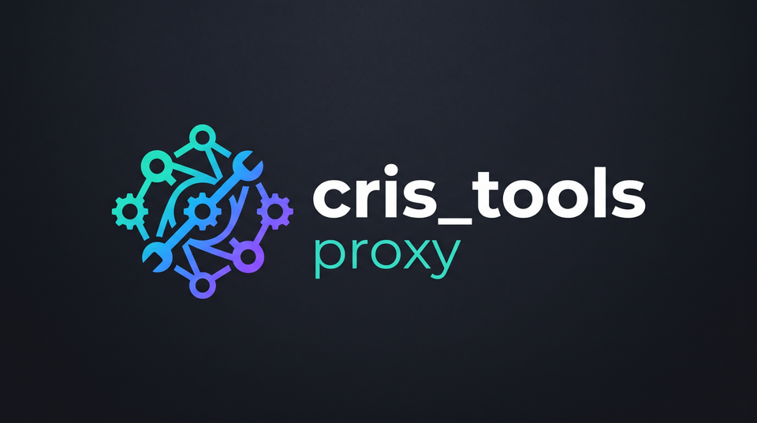

<p align="center">
  
</p>

# cris_tools_proxy

A small Rust program that lets voice commands (for example from Dragon) drive
CRIS Tools over a local socket. If CRIS Tools is not running it will launch it.
Release builds use the Windows GUI subsystem, so Dragon does not get a console
flash; diagnostics still go to the per-user proxy log.

```
cris_tools_proxy.exe [command]
```

`<command>` is the name of a registered automation in CRIS Tools (for example
`load_event_history` or `launch_maxims`). The proxy sends `run/<token>/<command>`
to the app's NNG listener on `tcp://<host>:<port>` (default
`tcp://127.0.0.1:5555`) and prints the response, where `<token>` is read from
the app's per-run `ipc.token` (see below). Token authentication is required by
default; set `require_token = false` only for a mixed-version rollout where the
app still accepts the legacy `run/<command>` form.

Run without a command to make sure CRIS Tools is running: if it is not, the
proxy launches it without asking. Use this for a desktop shortcut or a voice
command that simply opens CRIS Tools. Concurrent proxy invocations share a
per-user launch lock, so only one of them starts the app.

## Authentication

CRIS Tools writes a random token for the current run to
`%LOCALAPPDATA%\cris-tools\ipc.token` (mode 0600; `$XDG_RUNTIME_DIR` on Linux)
and rejects any command that does not present it. This stops other users or
sessions on a shared workstation from driving clinical automations. The proxy
reads the same file and includes the token on every request.

`require_token` defaults to `true`, so the proxy refuses to send if the token
file is missing rather than silently falling back to the rejected legacy form.
Set it to `false` only while rolling out a newer proxy against older app builds
that still accept `run/<command>`; once the app requires tokens, leave it on.
CRIS Tools now gives the token and diagnostics an owner-only Windows ACL. If the
proxy runs under a different account, it reports the resulting permission error
explicitly instead of claiming the token was never written.

## Command allowlist and refusal responses

CRIS Tools can optionally restrict which automations the listener will run with
`[commands] allowed` in the deployment's `config/global.toml`:

```toml
[commands]
allowed = ["load_event_history", "launch_maxims"]
```

The proxy does not need any allowlist configuration of its own; it simply sends
the requested command. If the app refuses it, the proxy shows a clear dialog and
exits non-zero instead of treating the refusal as success:

| Response | Meaning |
| --- | --- |
| `received` | Automation accepted. |
| `forbidden` | The command is not in `[commands] allowed` (or is not a registered automation while an allowlist is active); the dialog names the command and shows the config key to update. |
| `rate limited` | Too many commands arrived too quickly; wait and retry. |
| `invalid` | The IPC token was stale or missing; wait for startup or restart CRIS Tools. |
| `invalid function` | No automation with that name is registered; check the command name and loaded plugins. |

Unknown response values are printed as before so a future app response does not
break older proxies.

## Configuration (`cris_tools_proxy.toml`)

The config is looked up **next to the executable** first, then in the working
directory, so it works no matter what CWD the proxy is launched from.

| Key | Meaning |
| --- | --- |
| `port` | Port the app's command listener binds. Must match `[commands].port` in the app's `config/global.toml`. |
| `host` | Host/address of the command listener. Defaults to `127.0.0.1` to match the app's IPv4 bind. |
| `timeout_ms` | How long to wait for a command response, in milliseconds. Default `30000`. |
| `cris_tools_path` | Optional fallback executable used only when no published build is found. |
| `app_root` | Optional directory containing `app/current.txt` and the build zips. Defaults to the config file's directory; relative paths resolve against it. |
| `require_token` | When true, refuse to send if the app's IPC token file is missing instead of using the legacy protocol. Default `true`. Set false only for a mixed-version rollout. |
| `ipc_token_file` | Optional override for the app's `ipc.token` path. Defaults to `%LOCALAPPDATA%\cris-tools\ipc.token`. |
| `launch_without_prompt` | Default for launching CRIS Tools automatically instead of asking. A user's saved choice in the per-user preferences file overrides this. |
| `preferences_file` | Optional override for the per-user preferences file. Defaults to `%LOCALAPPDATA%\cris-tools\prefs.toml`. |

## Launching a published build

When the app is not running and the user chooses to launch it, the proxy looks
for `app/current.txt` (written last by `build_cris_tools.py` after publishing a
zip), extracts the matching `app/cris_tools_<version>.zip` into a per-user run
cache (`%LOCALAPPDATA%\cris-tools\run\<version>\`), and launches it from there
with `CRIS_TOOLS_DATA_DIR` pointed back at the share so `config/`, `plugins/`
and logs stay shared. Running from a local cache keeps startup fast and avoids
per-launch AV extraction. Cancelling the progress dialog aborts the launch.

The Windows executable embeds `icons/icon.ico` and version metadata through
`build.rs`, so Explorer, shortcuts and the taskbar show the CRIS Tools icon.
The banner above uses `icons/logo.png`; see `icons/README.md` for the resize
commands used to generate both assets.

If the user picks "always launch", the proxy saves `launch_without_prompt = true`
in a per-user preferences file (`%LOCALAPPDATA%\cris-tools\prefs.toml` by
default) and skips the prompt from then on for that user. Deleting that file
restores the prompt. After launching, the proxy waits for the app to become
ready and then sends the original command, so the user does not have to repeat
it. If the configured executable does not exist, the proxy shows an error
dialog instead of failing silently.
